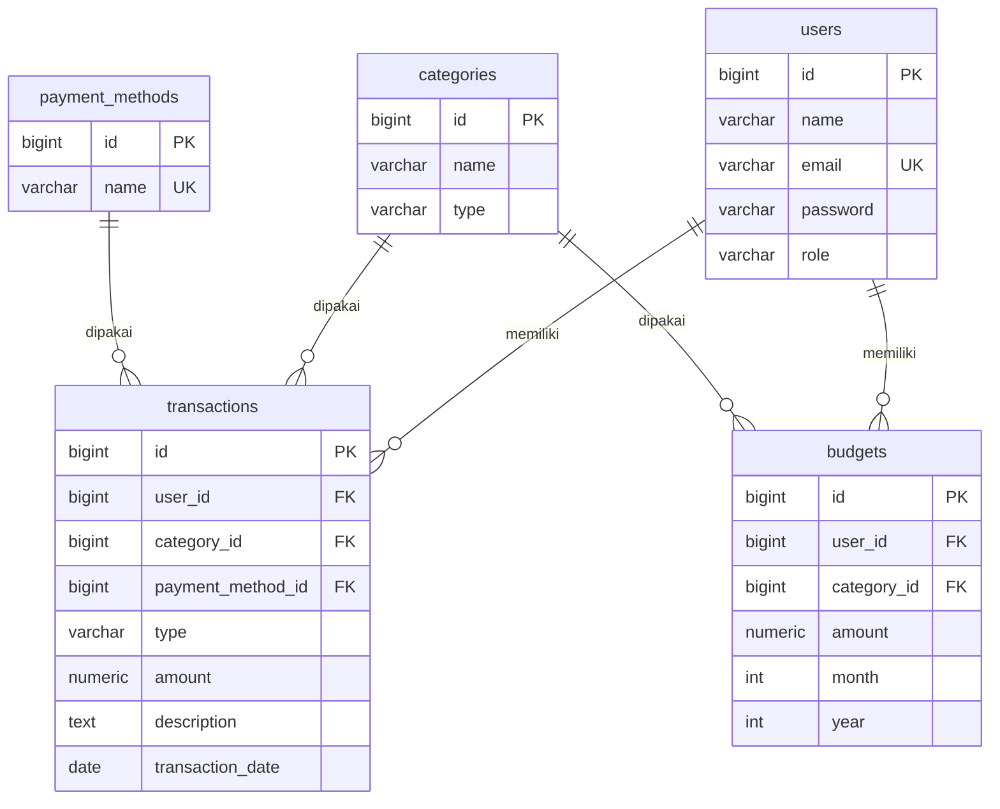

# Web Pencatatan Keuangan (Finance Tracker API)

REST API untuk mencatat dan mengelola transaksi keuangan (pemasukan dan pengeluaran), dibuat dengan **Python + FastAPI + SQLAlchemy + PostgreSQL**, dilindungi autentikasi **JWT**, dan di-deploy ke **Vercel**.

## 1. Deskripsi Project

Aplikasi berbasis REST API yang membantu pengguna mencatat, melihat, mengubah, dan menghapus transaksi keuangan, mengelompokkannya berdasarkan kategori, menyimpan metode pembayaran, serta mengatur batas anggaran per kategori. Project ini dibuat untuk memenuhi tugas akhir Backend Development: database relasional dengan minimal 5 tabel, REST API (GET, POST, PUT/PATCH, DELETE), deployment ke Vercel, pengujian dengan Postman/Thunder Client, dan dokumentasi API.

## 2. Tujuan Sistem

- Mencatat pemasukan dan pengeluaran pengguna.
- Mengelompokkan transaksi berdasarkan kategori.
- Menyimpan metode pembayaran yang digunakan.
- Mengatur batas anggaran per kategori per bulan.
- Mengamankan data keuangan dengan login (JWT) sehingga orang lain tidak bisa mengakses data seseorang.
- Menyediakan REST API dan database relasional dengan foreign key yang dapat diakses online setelah deployment.

## 3. Arsitektur Sistem

```text
Client (Browser / Postman / Thunder Client / Swagger UI)
        │  HTTP Request (JSON) + header Authorization: Bearer <token>
        ▼
Vercel ── REST API (FastAPI: GET, POST, PUT/PATCH, DELETE)
        │  SQLAlchemy ORM (psycopg)
        ▼
PostgreSQL (users, categories, transactions, payment_methods, budgets)
```

Struktur folder:

```text
finance-tracker/
├── app/
│   ├── main.py               # aplikasi FastAPI, CORS, registrasi router
│   ├── config.py             # pembacaan environment variable
│   ├── database.py           # engine & session SQLAlchemy
│   ├── models.py             # model tabel (ORM)
│   ├── schemas.py            # validasi request & bentuk response (Pydantic)
│   ├── security.py           # hash password (bcrypt) & JWT
│   ├── deps.py               # dependency: user login, wajib admin
│   ├── errors.py             # format error JSON seragam
│   ├── utils.py
│   ├── routers/              # auth, users, categories, payment_methods, transactions, budgets
│   └── web/                  # frontend: index.html (landing), login.html, dashboard.html, static/
├── database/schema.sql       # skema SQL (referensi untuk ERD)
├── docs/postman_collection.json
├── scripts/init_db.py        # membuat tabel & data awal
├── index.py                  # entry point Vercel
├── requirements.txt
└── README.md
```

## 4. ERD / Database



Skema SQL lengkap ada di [`database/schema.sql`](database/schema.sql); tabel dibuat otomatis dari model SQLAlchemy oleh `scripts/init_db.py`. Catatan desain:

- `transactions.user_id` dan `budgets.user_id` → `ON DELETE CASCADE` (hapus user = hapus datanya); `category_id` dan `payment_method_id` → `ON DELETE RESTRICT` (kategori/metode yang masih dipakai tidak bisa dihapus).
- `budgets` memiliki constraint unik `(user_id, category_id, month, year)`.
- Password disimpan sebagai hash bcrypt dan tidak pernah dikembalikan di response.
- `users.role` bernilai `user` (default) atau `admin`.

## 5. Daftar Endpoint

Semua resource memiliki CRUD lengkap dengan pola yang sama:

| Method | Path | Fungsi |
|---|---|---|
| GET | `/api/{resource}` | Ambil semua data |
| GET | `/api/{resource}/{id}` | Ambil satu data |
| POST | `/api/{resource}` | Tambah data |
| PUT | `/api/{resource}/{id}` | Ubah seluruh data (body lengkap) |
| PATCH | `/api/{resource}/{id}` | Ubah sebagian data |
| DELETE | `/api/{resource}/{id}` | Hapus data |

`{resource}` = `transactions` (resource utama), `users`, `categories`, `payment-methods`, `budgets`.

Filter opsional pada `GET /api/transactions`: `user_id` (admin), `category_id`, `payment_method_id`, `type`, `start_date`, `end_date`.
Contoh: `GET /api/transactions?type=expense&start_date=2026-10-01&end_date=2026-10-31`

Halaman web: `/` (landing page), `/login` (masuk/daftar), `/dashboard` (catat & lihat transaksi, ringkasan, anggaran). Halaman ini memakai API di atas dengan token JWT yang disimpan di browser.

Dokumentasi interaktif (Swagger UI) otomatis tersedia di `/docs` dan ReDoc di `/redoc`. Klik **Authorize** lalu tempel token hasil login untuk mencoba endpoint langsung dari browser.

### Autentikasi dan Hak Akses

Karena API menyimpan data keuangan, **semua endpoint `/api/*` kecuali registrasi dan login wajib memakai token JWT**.

| Method | Path | Fungsi |
|---|---|---|
| POST | `/api/auth/register` | Daftar akun baru (role selalu `user`), langsung mendapat token |
| POST | `/api/auth/login` | Login dengan email dan password, mendapat token |
| GET | `/api/auth/me` | Profil user yang sedang login |

Login:

```json
{ "email": "demo@example.com", "password": "demo123" }
```

Response `200`:

```json
{
  "message": "Login berhasil",
  "data": { "id": 2, "name": "Demo User", "email": "demo@example.com", "role": "user", "created_at": "2026-10-19T08:00:00Z" },
  "token": "eyJhbGciOi..."
}
```

Kirim token pada setiap request berikutnya:

```http
Authorization: Bearer <token>
```

Aturan hak akses:

| Resource | User biasa | Admin |
|---|---|---|
| `transactions`, `budgets` | Hanya data miliknya sendiri; `user_id` otomatis diisi dari token (nilai di body diabaikan) | Semua data (wajib mengisi `user_id` saat membuat) |
| `users` | Hanya akun miliknya sendiri (lihat, ubah, hapus); tidak bisa `POST /api/users` | Semua |
| `categories`, `payment-methods` | Hanya baca (GET) | CRUD penuh |

Data milik user lain dijawab `404` (bukan `403`) agar keberadaan datanya tidak bocor. Token berlaku sesuai `JWT_EXPIRES_MINUTES` (default 1440 menit = 1 hari) dan ditolak jika user-nya sudah dihapus.

## 6. Request dan Response

### Transactions

`POST /api/transactions`

```json
{
  "category_id": 4,
  "payment_method_id": 1,
  "type": "expense",
  "amount": 25000,
  "description": "Makan siang",
  "transaction_date": "2026-10-19"
}
```

Response `201`:

```json
{
  "message": "Transaksi berhasil ditambahkan",
  "data": {
    "id": 4,
    "user_id": 2,
    "category_id": 4,
    "category_name": "Makanan",
    "payment_method_id": 1,
    "payment_method_name": "Cash",
    "type": "expense",
    "amount": 25000.0,
    "description": "Makan siang",
    "transaction_date": "2026-10-19",
    "created_at": "2026-10-19T08:00:00Z"
  }
}
```

Aturan: `amount` > 0, `type` hanya `income`/`expense`, `transaction_date` berformat `YYYY-MM-DD` (default hari ini, zona WIB), `category_id` dan `payment_method_id` harus sudah ada. `user_id` diisi otomatis dari token untuk user biasa.

### Users

`POST /api/users` (khusus admin; pengguna biasa mendaftar lewat `/api/auth/register`) — body: `{ "name": "Budi", "email": "budi@example.com", "password": "rahasia123" }` (password 6–72 karakter, email unik).

### Categories

`POST /api/categories` (admin) — body: `{ "name": "Kesehatan", "type": "expense" }`

### Payment Methods

`POST /api/payment-methods` (admin) — body: `{ "name": "Kartu Debit" }`

### Budgets

`POST /api/budgets` — body: `{ "category_id": 4, "amount": 1500000, "month": 10, "year": 2026 }`

Response `GET` anggaran menyertakan `spent` (total pengeluaran kategori tsb pada bulan/tahun anggaran).

### Format error

```json
{ "error": "Transaksi tidak ditemukan" }
```

## 7. Status Code

| Status | Keterangan |
|---|---|
| 200 | Request berhasil |
| 201 | Data berhasil dibuat |
| 400 | Input tidak valid (validasi gagal, JSON rusak, ID salah, email duplikat, data masih dipakai) |
| 401 | Belum login, token tidak valid/kedaluwarsa, atau email/password salah |
| 403 | Login valid tetapi tidak punya hak akses (misalnya user biasa mengubah kategori) |
| 404 | Data / endpoint tidak ditemukan (termasuk `category_id`/`payment_method_id` yang tidak ada) |
| 500 | Server error |

## 8. URL Deployment

> Isi setelah deploy: `https://NAMA-PROJECT-ANDA.vercel.app` (dokumentasi interaktif di `/docs`)

## 9. Cara Menjalankan Secara Lokal

Prasyarat: Python 3.10+ dan PostgreSQL (lokal atau online seperti Neon/Supabase).

```bash
python -m venv .venv
source .venv/bin/activate        # Windows: .venv\Scripts\activate
pip install -r requirements.txt

cp .env.example .env             # lalu isi DATABASE_URL dan JWT_SECRET
python scripts/init_db.py --seed # buat tabel + data awal
uvicorn app.main:app --reload    # http://localhost:8000  (Swagger: /docs)
```

Data awal: kategori, metode pembayaran, akun admin `admin@example.com / admin123`, dan akun demo `demo@example.com / demo123`. Gunakan `python scripts/init_db.py --reset --seed` untuk menghapus semua tabel lalu membuat ulang.

Membuat `JWT_SECRET` acak: `python -c "import secrets; print(secrets.token_hex(32))"`

## 10. Deployment ke Vercel

Vercel mendeteksi FastAPI secara otomatis dari `requirements.txt` dan `index.py` (variabel `app`), tanpa konfigurasi tambahan.

1. Buat database PostgreSQL online (misalnya Neon atau Supabase) dan salin connection string-nya.
2. Dari komputer lokal, isi `DATABASE_URL` di `.env` dengan database online tersebut, lalu jalankan `python scripts/init_db.py --seed`.
3. Push project ke GitHub (`.env` sudah masuk `.gitignore`).
4. Di Vercel: **Add New → Project → import repository**.
5. Tambahkan Environment Variables `DATABASE_URL` dan `JWT_SECRET` (string acak minimal 16 karakter), lalu **Deploy**.
6. Buka `https://<domain-vercel>/docs`, login lewat `POST /api/auth/login`, lalu uji endpoint dengan token tersebut.

> Untuk production, set `ADMIN_PASSWORD` sebelum seed dan ganti/hapus akun demo.

## 11. Pengujian API

Import [`docs/postman_collection.json`](docs/postman_collection.json) ke Postman / Thunder Client, lalu ubah variabel `baseUrl` ke URL lokal (`http://localhost:8000`) atau URL Vercel. Jalankan request **Auth → Login** terlebih dahulu; token tersimpan otomatis ke variabel `token` dan dipakai semua request lain. Untuk menguji folder **Categories** dan **Payment Methods** (khusus admin), login dengan **Login (admin)**.

| Skenario | Endpoint | Hasil yang diharapkan |
|---|---|---|
| Register | `POST /api/auth/register` | 201 + token |
| Login berhasil | `POST /api/auth/login` | 200 + token |
| Login password salah | `POST /api/auth/login` | 401 |
| Akses tanpa token | `GET /api/transactions` | 401 |
| User biasa ubah kategori | `POST /api/categories` | 403 |
| Akses data milik user lain | `GET /api/transactions/{id user lain}` | 404 |
| GET semua data | `GET /api/transactions` | 200 |
| GET berdasarkan ID | `GET /api/transactions/1` | 200 |
| POST data baru | `POST /api/transactions` | 201 |
| PUT / PATCH | `PUT` / `PATCH /api/transactions/1` | 200 |
| DELETE | `DELETE /api/transactions/1` | 200 |
| Input tidak valid | `POST /api/transactions` body `{}` | 400 |
| Data tidak ditemukan | `GET /api/transactions/999999` | 404 |

Bukti pengujian (screenshot request/response):

> _Tempel screenshot di sini._

## 12. Teknologi

| Teknologi | Fungsi |
|---|---|
| Python 3 + FastAPI | Framework REST API (dokumentasi Swagger otomatis) |
| SQLAlchemy 2 + psycopg | ORM dan driver PostgreSQL |
| Pydantic | Validasi input dan bentuk response |
| PyJWT + bcrypt | Autentikasi token dan hash password |
| PostgreSQL | Relational database |
| Vercel | Deployment backend |
| Postman / Thunder Client | Testing API |
| GitHub | Repository project |
